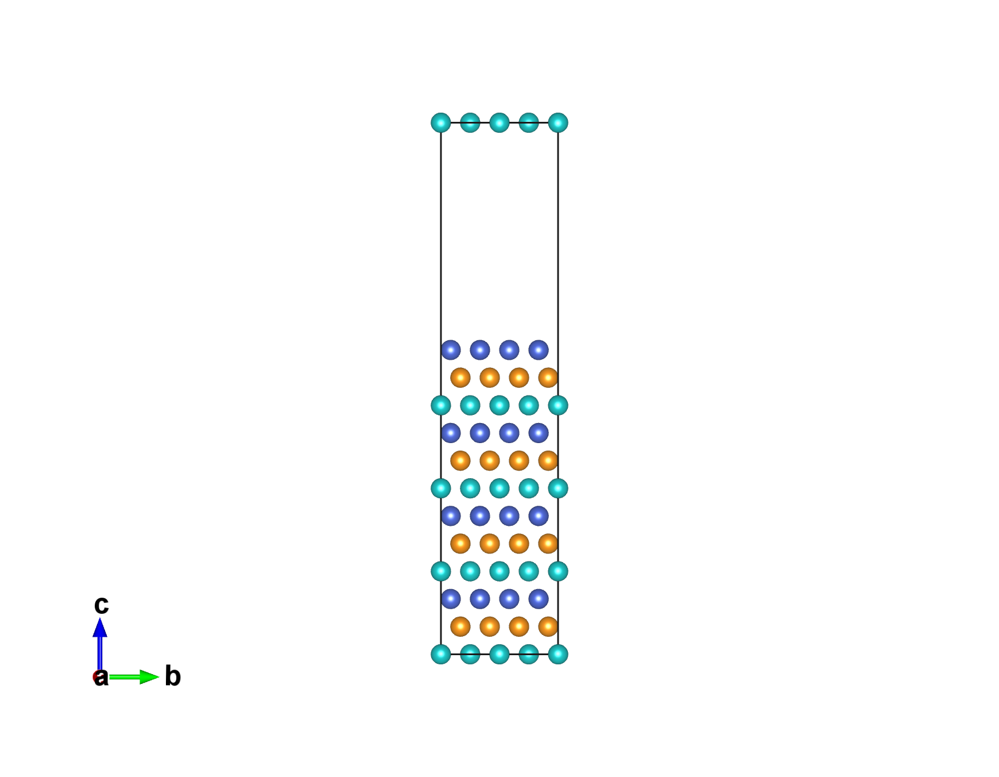
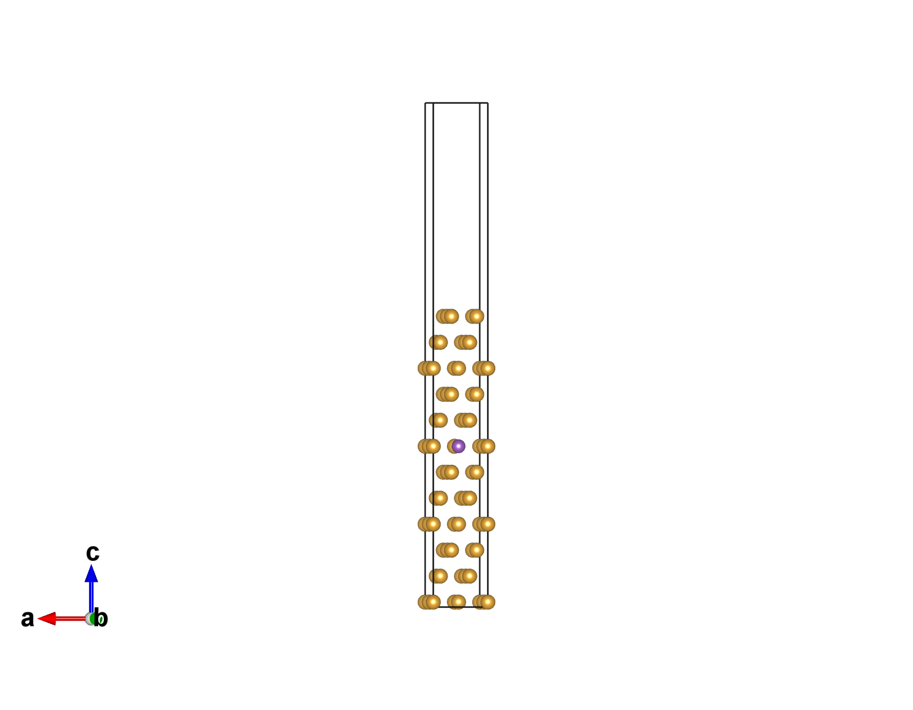

# dsh-vesta

[VESTA](https://jp-minerals.org/vesta/en/) 的 DSH 插件：在会话里直接打开结构文件、用命令行渲染图片、截取窗口、管理进程。不依赖截图识别，也不把屏幕像素塞进上下文。

- 五个工具：`vesta_status` / `vesta_open` / `vesta_export_image` / `vesta_screenshot` / `vesta_close`
- 渲染走 VESTA 自带的 `-export_img`，输出是普通 PNG，用 `read_image` 检查即可
- `.vesta` 场景支持 `view` / `zoom` / `boundary` / `background` 覆盖，写到临时副本，原场景不动

## 环境

| 项 | 要求 |
| --- | --- |
| 系统 | Windows（插件调用 `PowerShell` 与 Win32 窗口接口） |
| VESTA | **3.90.6a** 实测；**3.4.5 及更早版本未验证**，旧版可能没有 `-export_img`。`VESTA.ini` 里的 `3.4.5` 是该文件格式的版本常量，不是程序版本；`vesta_status` 从 `VESTA.exe` 内部字符串读取真实构建号 |
| DSH | 0.2.1 及以后（插件行 id `vesta`） |
| Node | >= 22 |

VESTA 是免费软件，但**不随本仓库分发**：请从 [官网](https://jp-minerals.org/vesta/en/download.html) 自行安装，并遵守其许可与引用要求。

## 安装

1. 用 DSH 插件管理器 `install_bundle` 指向本目录；
2. 在 profile 的 `cordis.patch.yml` 里填 VESTA 路径：

```yaml
- id: vesta
  name: 'dsh-vesta'
  config:
    vestaPath: 'C:\Program Files\VESTA-win64\VESTA.exe'
    defaultScale: 2
    exportTimeoutMs: 120000
```

也可以用环境变量 `VESTA_EXE`，优先级：`vestaPath` > `VESTA_EXE` > 报错。

3. 重启 DSH，刷新页面；在插件管理器里确认 `vesta` 行是 active。

## 工具

| 工具 | 作用 |
| --- | --- |
| `vesta_status` | 安装路径、版本（读 `VESTA.ini` 头）、正在运行的窗口 |
| `vesta_open` | 用 VESTA 打开 CIF / POSCAR / `.vesta`；单实例时会转发到已有窗口 |
| `vesta_export_image` | 命令行渲染 PNG；支持 `view` / `zoom` / `boundary` / `background` / `saveSceneAs` |
| `vesta_screenshot` | 截取 VESTA 窗口（检查界面状态用） |
| `vesta_close` | `WM_CLOSE`，必要时强制结束 |

## 场景覆盖参数

`vesta_export_image` 对 `.vesta` 场景支持四个覆盖参数，写入临时副本后渲染，原场景不变：

| 参数 | 含义 | 示例 |
| --- | --- | --- |
| `view` | 晶向视角 `[h,k,l]` | `[0,0,1]` 沿 c 轴看，`[1,1,0]` 对角视角 |
| `zoom` | 模型缩放（VESTA 默认约 0.458） | `0.9` |
| `boundary` | 显示范围（分数坐标） | `[0,1,0,1,0,1]` 一个晶胞 |
| `background` | 背景色 `[r,g,b]` | `[20,24,32]` 深色背景 |

视角矩阵按「a 沿 x、b 在 xy 平面」的笛卡尔约定换算，c 轴默认朝上。

## 示例

`examples/` 里有两个复现案例（FCC-Fe (111) 12 层滑移模型、Fe47X1 表面模型），演示如何用脚本生成 `.vesta` 场景，再用插件渲染：

| FCC-Fe (111) 12 层，侧视 | Fe47Mo1 表面，斜视 |
| --- | --- |
|  |  |

```powershell
python examples/fe-figure/generate.py --out examples/fe-figure
# 然后在会话里：
# vesta_export_image input=examples/fe-figure/fe_slab.vesta view=[1,0,0] zoom=0.8 scale=2
```

- `examples/compose.py`：把参考图与渲染图拼成对比（参考图需自备，论文原图不随仓库分发）
- 两个 `generate.py` 需要 `numpy`：`pip install numpy pillow`

## 能力边界

- **VESTA 是单实例程序**：已有窗口时，`vesta_open` / `vesta_export_image` 会把文件转发给正在运行的实例，在其中新开标签页并切换过去。需要完全隔离的批量渲染时，先 `vesta_close`。
- 样式（多面体、空间填充、线框）、逐元素半径/颜色、光照和标签尚未提供程序化覆盖；需要这些效果时，先在 VESTA 里调好并另存一个 `.vesta` 场景作为模板，再用 `view` / `zoom` / `boundary` / `background` 覆盖。
- 不读取 VESTA 内存里的实时状态；要精确控制画面，请生成或修改 `.vesta` 场景文件后再渲染。
- 截屏是屏幕 `BitBlt`（失败回退 `PrintWindow`），窗口被遮挡或完全移出屏幕时可能不完整。

## 后续阶段

- 阶段 2：薄注入 DLL（命名管道命令通道、帧缓冲直取、保存/导出事件镜像）。
- 阶段 3（可选）：内存级状态读取。

## 许可

MIT，见 [LICENSE](LICENSE)。版权：dhd（[dhd78](https://github.com/dhd78)）。
AI 参与声明见 [AI-DISCLOSURE.md](AI-DISCLOSURE.md)；第三方与 VESTA 边界见 [THIRD_PARTY_NOTICES.md](THIRD_PARTY_NOTICES.md)。

## English

`dsh-vesta` lets a DSH session drive [VESTA](https://jp-minerals.org/vesta/en/): open structure files, render PNGs through VESTA's `-export_img`, capture the window, and close it. Renders are plain files checked with `read_image`, so no OCR or screenshot parsing is involved. VESTA itself is not bundled — install it yourself and follow its license.
